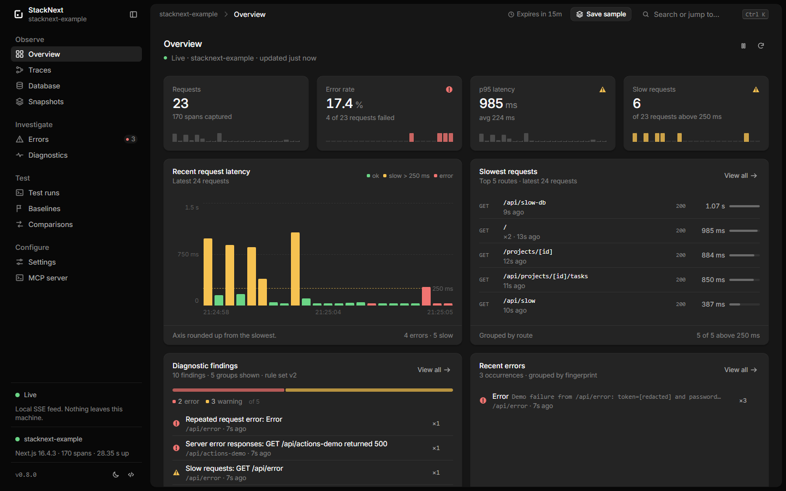
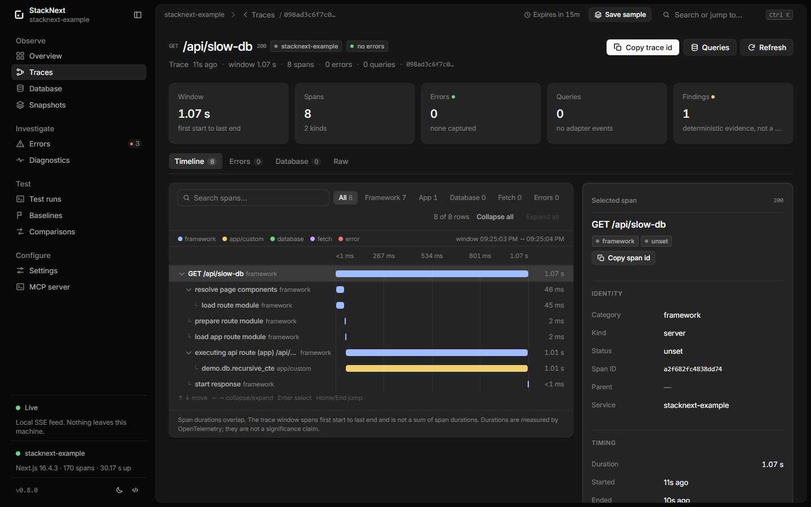
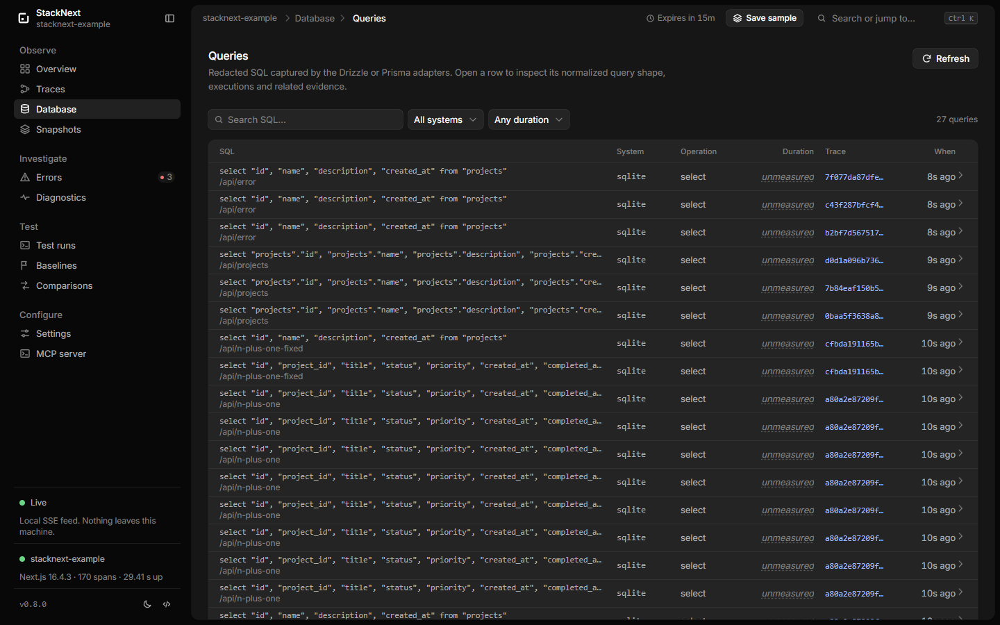

<p align="center">
  <picture>
    <source media="(prefers-color-scheme: dark)" srcset="brand/png/app-icon-dark-256.png">
    <source media="(prefers-color-scheme: light)" srcset="brand/png/app-icon-light-256.png">
    
  </picture>
</p>

<h1 align="center">StackNext</h1>

<p align="center"><strong>Local-first runtime inspection for Next.js App Router applications.</strong></p>

<p align="center">
  <a href="https://www.npmjs.com/package/@stacknext/cli"></a>
  
  
  <a href="LICENSE"></a>
</p>

StackNext is a free, MIT-licensed debugging center for Next.js. It collects
OpenTelemetry spans from your dev server, adds Drizzle/Prisma query events and
server errors, and shows them in a local dashboard, CLI and read-only MCP
server. It also derives deterministic diagnostic findings, compares
Playwright-linked runtime captures against saved baselines, and freezes the
current sample into redacted snapshots that outlive the live retention window.
There is no cloud account, hosted backend, AI API client or telemetry upload.

**Start here:** [Quick start](#quick-start) · [Installation](apps/docs/installation.md) · [CLI commands](apps/docs/getting-started.md#commands) · [MCP server](apps/docs/mcp.md) · [Privacy](apps/docs/privacy.md)



<p align="center"><sub>Local telemetry, deterministic findings and saved evidence — no hosted backend.</sub></p>

## Quick start

Add StackNext to an existing Next.js 15/16 App Router project:

```bash
npm install --save-dev @stacknext/cli @stacknext/next
npx stacknext init
npx stacknext dev
```

Or with pnpm:

```bash
pnpm add -D @stacknext/cli @stacknext/next
pnpm exec stacknext init
pnpm exec stacknext dev
```

`init` writes `stacknext.config.json` and creates `instrumentation.ts` (or
`instrumentation.js` for a JavaScript project) only when no instrumentation file
exists. `dev` starts the loopback collector and your app's own `dev` script.
Open the dashboard URL it prints, usually `http://127.0.0.1:4400`, and make a
request to your app.

Already have `instrumentation.ts`, middleware, a proxy or an OpenTelemetry
provider? StackNext preserves them and prints the hook to add manually. It yields
to an existing tracer provider instead of replacing it.

Installation, upgrade and cleanup: [apps/docs/installation.md](apps/docs/installation.md)
and [apps/docs/uninstall.md](apps/docs/uninstall.md). Supported combinations:
[apps/docs/compatibility.md](apps/docs/compatibility.md).

## Try the example app

From a checkout of this repository:

```bash
nvm use                  # or the equivalent for fnm, asdf or mise
corepack enable          # activates the pnpm version from package.json
pnpm install
pnpm build
cd apps/example
pnpm exec stacknext dev --open
```

Node 24 is pinned in `.nvmrc`; `.devcontainer/` provides the same toolchain and
Playwright browsers for VS Code Dev Containers and the Dev Containers CLI. See
[CONTRIBUTING.md](CONTRIBUTING.md) for the full development setup, including
Playwright browser dependencies on Linux and the Codespaces limitation.

### Recover data from the former example

`apps/example` uses its own `data/stacknext-demo.db` and `.stacknext/baselines/`.
It does not automatically migrate `apps/example-next-app`. Stop both apps before
recovering data and keep a backup of both directories, including SQLite `-wal`
and `-shm` files. Do not delete the former app's files.

The old and new database schemas match. Use SQLite's backup API (available via
the app's `better-sqlite3` dependency) to create a consistent database in a new,
unused recovery directory, rather than copying an open database file. From
`apps/example`, after dependencies are installed:

```bash
node --input-type=module <<'JS'
import Database from 'better-sqlite3'
import { mkdirSync, existsSync } from 'node:fs'
const destination = 'data/recovered/stacknext-demo.db'
mkdirSync('data/recovered', { recursive: true })
if (existsSync(destination)) throw new Error('Recovery destination already exists')
const source = new Database('../example-next-app/data/stacknext-demo.db', {
  readonly: true, fileMustExist: true,
})
try { await source.backup(destination) } finally { source.close() }
JS
STACKNEXT_EXAMPLE_DATA_DIR="$PWD/data/recovered" pnpm exec stacknext dev --open
```

This preserves the new database even if it has already been seeded. The recovered
database becomes the selected database; the app does not merge tasks or resolve
conflicting ids. Keep using the same data-directory override on later starts.
Do not call `/api/seed` on the recovered database: that resets its tasks.

For baselines, use the [documented artifact portability workflow](apps/docs/baselines.md#sharing-and-portability):
copy individual immutable `base-*.json` records from the former app's
`.stacknext/baselines/` into the new app's `.stacknext/baselines/` only when the
destination id is absent. Create the directory with mode `0700`, retain `0600`
file permissions, and never overwrite an existing record or copy `run.json`.
If an id already exists, retain both originals in their current directories and
inspect them with `stacknext baseline show <id>` from each app directory.
The CLI has no baseline import or merge command. Validate recovered records with
`stacknext baseline list` and `stacknext baseline show <id>` from the new app.
Old baselines retain their scenario identities and project/environment metadata;
changed identities or environments can make comparisons inconclusive. Capture a
new baseline for the rebuilt app using the [baseline workflow](apps/docs/baselines.md#create-a-baseline).

For isolated Playwright captures, start a dedicated runtime with
`STACKNEXT_EXAMPLE_DATA_DIR="$PWD/data/e2e" pnpm exec stacknext dev`.
The example tests reset `/api/seed` before every repetition; use this dedicated
database for direct Playwright runs as well. `pnpm test:e2e` starts it automatically
and requires any existing example runtime to be stopped first.

Then visit the demo routes listed below.

This path is for contributors; the package quick start above is the normal user
path.

## Why it exists

Next.js ships useful OpenTelemetry spans, but turning them into an everyday
debugging workflow usually means adopting a hosted APM. StackNext keeps the
feedback loop local: start your app with one command, make a request, and see
the request, waterfall, database queries and errors on your machine.

- **Requests** — HTTP-request view of the trace list with route, method,
  status, duration, span/error/query counts, slow-request filtering and live
  updates.
- **Traces** — canonical list and detail with a category-aware parent/child
  waterfall for framework, app, database and fetch spans, plus attributes,
  events, warnings and missing parent detection.
- **Instrumentation coverage** — evidence-based `observed`, `active`,
  `configured`, `not-observed`, `unknown` and `unsupported` statuses for
  framework spans, adapters, custom spans and Server Actions. No misleading
  percentage.
- **Database** — redacted Drizzle and Prisma SQL, operation, success state,
  trace correlation and null-duration labeling where the adapter cannot measure.
- **Errors** — grouped fingerprints, redacted messages and stacks, and
  correlation to the request trace that produced them.
- **Custom spans and Server Actions** — optional helpers add application work
  and successful action spans to the same request trace.
- **Diagnostics** — deterministic, evidence-backed findings for repeated queries,
  slow spans, repeated external HTTP calls and error fingerprints. The same
  findings feed the CLI, dashboard, export and MCP; none of them is presented as
  a confirmed root cause.
- **Runtime regression testing** — Playwright scenarios correlate to verified
  server traces, capture runs save the evidence, and saved baselines are
  compared with deterministic medians and thresholds. Statuses are `improved`,
  `regressed`, `unchanged` or `inconclusive`; there is no significance claim.
- **Saved snapshots** — freeze the current sample into a redacted local file
  before it ages out. Save manually from the dashboard or CLI, automatically on
  a graceful exit and on the first error, then browse full traces, errors and
  database queries read-only. Automatic snapshots keep the newest ten by
  default; manual and imported snapshots are never rotated away.
- **MCP** — twenty read-only tools for coding agents, over local stdio, with
  structured output, response metadata, coverage summary, diagnostic findings,
  regression records, saved snapshots and optional guided prompts.
- **Agent Skill** — a portable `stacknext-debugging` skill with evidence-first
  workflows for errors, latency, database activity, traces, diagnostic findings,
  coverage gaps and runtime regression evidence.
- **Privacy boundary** — no bodies, headers, cookies, query values or SQL bind
  parameters. Redaction happens in the app and again in the collector.
- **Real local UX** — SSE updates, dark/light themes, responsive layout and
  useful empty states.

## Requirements

- Node.js **20.9+**. Public package validation runs on Node.js 22, 24 and 26;
  see the [compatibility matrix](apps/docs/compatibility.md) for the current
  tested set.
- npm, pnpm, yarn or bun to install the CLI and run your app.
- Next.js **15 or 16** with the **App Router**, on the **Node.js runtime**.
- Playwright **1.40+** only if you use runtime regression testing.

> 0.11.0 is the current package release. All ten packages are published under
> `@stacknext/cli` and `@stacknext/*`; the dashboard and regression packages are
> installed automatically as CLI dependencies. Next.js runtime verification in
> this repository used **Next.js 16.4.3** and **15.5.28**.

## Demo routes

From the repository checkout, open `http://127.0.0.1:4400` after the example
app starts, then visit:

| URL | What it demonstrates |
| --- | --- |
| `http://127.0.0.1:4402/` | Server render with Drizzle queries |
| `http://127.0.0.1:4402/api/projects` | JSON route |
| `http://127.0.0.1:4402/api/slow?delay=350` | Slow request |
| `http://127.0.0.1:4402/api/error?token=demo-url-secret` | Failing route with a fake secret |
| `http://127.0.0.1:4402/api/custom-work` | Custom async and sync spans |
| `http://127.0.0.1:4402/actions-demo` | Server Action helper demo |
| `http://127.0.0.1:4402/api/n-plus-one` | Eight repeated task queries |
| `http://127.0.0.1:4402/api/n-plus-one-fixed` | Batched counterpart |
| `http://127.0.0.1:4402/api/slow-db` | Slow recursive database query |
| `http://127.0.0.1:4402/api/repeated-fetch` | Three uncached fetches |

The example app is a small task tracker called StackNext Example. It uses
better-sqlite3 and Drizzle, seeds itself on first run, and includes deliberate
slow, throwing, custom-span and Server Action routes so every dashboard view has
real data.

With `stacknext dev` running, inspect the same sample from the CLI:

```bash
pnpm exec stacknext coverage
pnpm exec stacknext coverage --json
pnpm exec stacknext diagnose
pnpm exec stacknext diagnose --json
```

## Dashboard

| Trace detail | Database queries |
| --- | --- |
|  |  |

Routes: `/`, `/traces` (`?view=requests` for the HTTP-request view),
`/traces/:traceId`, `/database`, `/errors`, `/errors/:errorId`, `/diagnostics`,
`/diagnostics/:id`, `/runs`, `/runs/:id`, `/baselines`, `/baselines/:id`,
`/comparisons`, `/comparisons/:id`, `/snapshots`, `/snapshots/:id`,
`/snapshots/:id/traces`, `/snapshots/:id/traces/:traceId`,
`/snapshots/:id/errors`, `/snapshots/:id/errors/:errorId`,
`/snapshots/:id/database`, `/settings` and `/mcp`. Legacy `/requests` and
`/requests/:traceId` URLs redirect to the request view and trace detail.

## Integrations and manual setup

`init` detects Next.js and the App Router, writes `stacknext.config.json`,
creates `instrumentation.ts` (or `instrumentation.js` for a JavaScript project),
and prints adapter setup for Drizzle/Prisma. It **never overwrites an existing
instrumentation file**; it prints a manual hook instead. StackNext also yields to
an already-registered OpenTelemetry provider rather than replacing existing
monitoring. See [installation](apps/docs/installation.md) for upgrade and
configuration details.

Drizzle:

```ts
import { createStackNextDrizzleLogger } from '@stacknext/drizzle'

const db = drizzle(client, {
  logger: createStackNextDrizzleLogger({ databaseSystem: 'sqlite' }),
})
```

Prisma:

```ts
import { instrumentPrismaClient } from '@stacknext/prisma'

const prisma = new PrismaClient({
  log: [{ emit: 'event', level: 'query' }],
})
instrumentPrismaClient(prisma, { databaseSystem: 'postgresql' })
```

Add optional application spans when the built-in framework spans are not
specific enough:

```ts
import { withStackNextSpan } from '@stacknext/next'

const project = await withStackNextSpan('project.load', () => loadProject(id))
```

```ts
'use server'

import { withStackNextAction } from '@stacknext/next'

export async function saveProject(formData: FormData) {
  return withStackNextAction('action/save-project', () =>
    saveProjectFromForm(formData),
  )
}
```

Full setup and configuration: [apps/docs/getting-started.md](apps/docs/getting-started.md).
Instrumentation coverage: [apps/docs/instrumentation-coverage.md](apps/docs/instrumentation-coverage.md).
Custom spans: [apps/docs/custom-instrumentation.md](apps/docs/custom-instrumentation.md).
Server Actions: [apps/docs/server-actions.md](apps/docs/server-actions.md).

## CLI

```bash
stacknext init [--install]
stacknext dev [--open] [--quiet] [--token <token>] [nextArgs...]
stacknext status [--json]
stacknext doctor [--json]
stacknext coverage [--json]
stacknext diagnose [--id <diagnostic-id>] [--trace-id <trace-id>] [--category <category>] [--severity <severity>] [--json]
stacknext capture [--name <name>] [--project <name>] [--attach] [--url <url> --token <token>] [--json] [--quiet] -- <test command...>
stacknext runs list [--limit <n>] [--offset <n>] [--json]
stacknext runs show <run-id> [--json]
stacknext baseline save <run-id> --name <name> [--notes <text>] [--json]
stacknext baseline list [--limit <n>] [--offset <n>] [--json]
stacknext baseline show <baseline-id> [--json]
stacknext baseline remove <baseline-id> --yes [--json]
stacknext compare <baseline-id> <candidate-run-id> [--json] [--fail-on regression|inconclusive|any]
stacknext snapshot save [--label <text>] [--json]
stacknext snapshot list [--limit <n>] [--offset <n>] [--json]
stacknext snapshot show <snapshot-id> [--json]
stacknext snapshot export <snapshot-id> [-o <file> | --stdout] [--force]
stacknext snapshot import <file> [--label <text>] [--json]
stacknext snapshot delete <snapshot-id> --yes [--json]
stacknext export [-o <file> | --stdout] [--force]
stacknext uninstall [--yes] [--keep-config] [--remove-data] [--json]
stacknext mcp [--collector <url>] [--token <token>]
```

`dev` starts the loopback collector, writes runtime state to
`.stacknext/run.json` (`0600`), then runs the app's own `dev` script with the
collector URL and token in its environment. `status`, `doctor`, `coverage`,
`diagnose`, `snapshot`, `export` and `mcp` use that runtime state. `doctor` is
the first stop when data is missing; `coverage` shows what the current sample
actually observed; `diagnose` lists or opens deterministic findings with
filters; `snapshot` freezes the current sample into a redacted local file. Set
`instrumentation.verbose` or `NEXT_OTEL_VERBOSE=1` for the documented expanded
Next.js span set; `dev` prints the effective state because verbose tracing adds
span volume and dev-server overhead.

## Runtime regression testing

`@stacknext/playwright` is optional. It injects W3C trace context into browser
requests, proves that the server trace is a child of the injected request, and
submits each Playwright sample to the active capture run. Correlation is never
guessed from a time window.

```ts
import { stackNextFixtures } from '@stacknext/playwright'

const { test, expect } = stackNextFixtures()

test(
  'renders the overview',
  { annotation: { type: 'stacknext.scenario', description: 'app.overview' } },
  async ({ page }) => {
    await page.goto('/')
    await expect(page.getByRole('heading', { name: 'Projects' })).toBeVisible()
  },
)
```

With the app running through `stacknext dev`, capture a baseline and compare a
candidate:

```bash
pnpm exec stacknext capture --name "baseline" --quiet --json \
  -- pnpm exec playwright test --workers=1 --repeat-each=3 > baseline.json
RUN_ID=$(jq -r .run.id baseline.json)
pnpm exec stacknext baseline save "$RUN_ID" --name "baseline" --json > saved.json
BASELINE_ID=$(jq -r .baseline.id saved.json)

pnpm exec stacknext capture --name "candidate" --quiet --json \
  -- pnpm exec playwright test --workers=1 --repeat-each=3 > candidate.json
CANDIDATE_ID=$(jq -r .run.id candidate.json)
pnpm exec stacknext compare "$BASELINE_ID" "$CANDIDATE_ID" --json
```

The default is report-only. Add `--fail-on regression` in CI to exit non-zero
only for a regression. The dashboard has `/runs`, `/baselines` and
`/comparisons` views, and the MCP server exposes the same records read-only.
Captured runs use one Playwright worker; see
[apps/docs/regression-testing.md](apps/docs/regression-testing.md) for the full workflow,
[apps/docs/playwright-integration.md](apps/docs/playwright-integration.md) for fixture
setup, and [apps/docs/comparison-methodology.md](apps/docs/comparison-methodology.md) for
the thresholds and status rules.

## Saved snapshots

The live sample is in memory and pruned by `collector.retentionMs`, so a
reproduction can age out before you investigate it. A snapshot freezes the
current redacted sample into `.stacknext/snapshots` without changing the live
store:

```bash
pnpm exec stacknext snapshot save --label "before index change"
pnpm exec stacknext snapshot list
pnpm exec stacknext snapshot show snap-0123456789abcdef
pnpm exec stacknext snapshot export snap-0123456789abcdef -o sample.json
pnpm exec stacknext snapshot import sample.json --label "reported issue"
pnpm exec stacknext snapshot delete snap-0123456789abcdef --yes
```

The dashboard exposes the same records at `/snapshots`, including read-only
traces, errors, database queries and raw export. Snapshots also save
automatically on a graceful `stacknext dev` exit and on the first error after a
60-second cooldown. Automatic exit/error snapshots keep the newest ten by
default; manual and imported snapshots are never rotated away. Each snapshot is
capped at 64 MiB and an oversized save fails instead of truncating.

Snapshots are evidence from the save time, not current app state. They contain
spans, errors, database queries, the captured config and limitations, but no
live diagnostics or coverage. They are never replayed into the live store and
never uploaded. Configure the behavior under `snapshots` in
`stacknext.config.json`:

```json
{
  "snapshots": {
    "autoOnExit": true,
    "autoOnError": true,
    "autoKeep": 10,
    "maxBytes": 67108864
  }
}
```

## MCP

```json
{
  "mcpServers": {
    "stacknext": {
      "command": "npx",
      "args": ["--no-install", "stacknext", "mcp"],
      "cwd": "/absolute/path/to/your-app"
    }
  }
}
```

Start `stacknext dev` before the MCP client. The server is stdio-only,
read-only, and refuses non-loopback collector URLs. With pnpm, use
`pnpm --dir /absolute/path/to/your-app exec stacknext mcp` instead. Tools:

`get_project_summary`, `list_requests`, `get_request`, `list_traces`,
`get_trace`, `list_errors`, `get_error`, `list_database_queries`,
`find_slow_requests`, `stacknext_list_diagnostics`,
`stacknext_get_diagnostic`, `stacknext_list_test_runs`,
`stacknext_get_test_run`, `stacknext_list_baselines`, `stacknext_get_baseline`,
`stacknext_list_comparisons`, `stacknext_get_comparison`,
`stacknext_list_snapshots`, `stacknext_get_snapshot`,
`stacknext_get_snapshot_trace`.

Successful responses keep the existing JSON text content and add
`structuredContent`, output schemas and a `meta` object with pagination,
connection and completeness information. `get_project_summary` also returns the
instrumentation coverage report and a compact `meta.coverage` summary, so an
agent can separate missing instrumentation from an absent runtime problem. The
two diagnostics tools return the same findings as the CLI and dashboard;
`get_trace` adds references to related findings. The six regression tools read
capture runs, baselines and comparisons from `.stacknext` without capturing,
saving, deleting or mutating anything. The three snapshot tools list and read
saved snapshots, their summary and one scoped trace; they never create, import
or delete a snapshot. Five optional prompts
(`diagnose-error`, `investigate-slow-request`, `inspect-database-activity`,
`investigate-trace`, `diagnose-runtime-issue`) provide guided entry points.

## AI coding agent integration

StackNext is designed to be used by coding agents without an AI API key or
subscription. The portable skill at
[`skills/stacknext-debugging`](skills/stacknext-debugging/SKILL.md) teaches six
evidence-first workflows:

- **A — runtime error:** find the error, read the stack, follow the correlated
  trace.
- **B — slow request:** rank slow requests, inspect the timeline and find the
  measured bottleneck.
- **C — database investigation:** inspect redacted SQL, failures, null durations
  and trace correlation.
- **D — general runtime investigation:** summarize the current state with
  explicit evidence and completeness caveats.
- **E — diagnostic findings:** list findings, open one, verify its evidence and
  report what remains unproven.
- **F — runtime regression evidence:** inspect a capture run, baseline or
  deterministic comparison without presenting it as statistical significance or
  a confirmed cause.
- **G — saved snapshot evidence:** open a frozen snapshot, inspect its scoped
  traces, errors and database queries, and state clearly that it is not current
  live telemetry.

The skill also has a coverage-check workflow that uses `meta.coverage` and the
summary coverage report to distinguish a feature that was not exercised from one
that is missing or unsupported.

Install the whole skill directory into your client's project skill path:

```bash
pnpm exec stacknext skill install --client opencode
pnpm exec stacknext skill install --client codex
pnpm exec stacknext skill install --client claude-code
```

`stacknext skill path` prints the bundled directory, and `--force` replaces an
existing copy. The skill ships inside `@stacknext/cli`; the repository copy
remains the canonical source. Do not overwrite existing instruction files; add
the marked block from
[apps/docs/integrations/agent-instructions.md](apps/docs/integrations/agent-instructions.md)
to `AGENTS.md` or `CLAUDE.md` only after reviewing it.

Client setup:

- [OpenCode](apps/docs/integrations/opencode.md)
- [Codex](apps/docs/integrations/codex.md)
- [Claude Code](apps/docs/integrations/claude-code.md)
- [MCP tools, prompts and response metadata](apps/docs/mcp.md)
- [Agent compatibility suite and current results](docs/testing/agent-compatibility.md)

The agent should start with `get_project_summary`, cite tool evidence, check
`meta.completeness`, and treat `null` Drizzle query durations as unmeasured, not
zero. StackNext never requires a hosted model; the client you choose may still
log or transmit tool results according to its own policy.

## Privacy

StackNext never captures request/response bodies, headers, cookies, URL query
values or SQL bind parameters. Every attribute map, including attributes passed
to custom span and Server Action helpers, passes through a redaction layer in
the app process and again in the collector. URLs lose their query strings and
fragments; passwords, tokens, cookies, authorization values, credential-bearing
URLs and known secret formats are replaced with `[redacted]`.

The collector binds to `127.0.0.1`, requires a bearer token for ingestion and
read APIs, issues a `HttpOnly`/`SameSite=Strict` dashboard session cookie,
validates payloads with Zod, rejects cross-site requests and enforces 2 MiB
ingest payloads. Telemetry is in memory, bounded and retention-pruned. Capture
runs, baselines, comparisons and snapshots are redacted JSON records under
`.stacknext` with private permissions; they are not uploaded and are never
pruned automatically except for automatic exit/error snapshots, which keep the
newest ten by default. Snapshots are redacted again on import.

Read [apps/docs/privacy.md](apps/docs/privacy.md) for the full data table and caveats.
Redaction is pattern-based, not a formal secret scanner: review exports before
sharing them.

## Limitations

This is a local development tool. Edge runtime, the Pages Router, production
monitoring and multi-user hosting are out of scope. Server Components are not
individually traced, Server Actions require the explicit
`withStackNextAction()` helper, and Drizzle query durations are unavailable
through its logger API. Coverage describes only the current retention window;
`not-observed` and `unknown` are not proof of a broken app. Diagnostics are
deterministic heuristics over the same window, not confirmed root causes, and
they do not read source, run SQL/EXPLAIN or recommend indexes. Regression
comparisons use Playwright-linked samples, medians and explicit thresholds; they
are not statistical tests, do not prove causality and report `inconclusive` when
the environment or evidence is insufficient. Snapshots are frozen copies from
their save time: they do not update, carry no live diagnostics or coverage, and
do not prove current behavior. See [apps/docs/limitations.md](apps/docs/limitations.md).

## Repository layout

```
packages/core       wire types, schemas, redaction, store, transport
packages/diagnostics deterministic diagnostic rules and report
packages/regression capture records, baselines, comparisons, storage
packages/playwright optional Playwright fixture and trace correlation
packages/next       Next.js instrumentation + OpenTelemetry exporter
packages/drizzle    Drizzle logger adapter
packages/prisma     Prisma query adapter
packages/cli        stacknext binary + collector HTTP server
packages/dashboard  React/Vite dashboard served by the collector
packages/mcp        read-only stdio MCP server
skills/             portable Agent Skills for coding agents
apps/example        StackNext Example demo
apps/www            StackNext website (private)
apps/docs           public Mintlify documentation site
docs/               contributor and engineering knowledge base
```

More detail: [architecture overview](docs/architecture/overview.md) and the
[public architecture page](apps/docs/architecture.md).

## Development

```bash
pnpm install
pnpm exec playwright install chromium   # for the example Playwright scenarios
pnpm lint
pnpm typecheck
pnpm test
pnpm build
pnpm test:e2e      # starts the built example app and checks the real stack
pnpm test:packages # packs and validates all ten public archives
pnpm test:consumer # installs archives in an external Next.js fixture
pnpm check:docs    # generated docs, website changelog, links and documented commands
pnpm changelog:sync # regenerate website changelog data from CHANGELOG.md
pnpm changelog:check # fail when the generated website changelog is stale
pnpm benchmark     # synthetic ingest + read API benchmark
pnpm benchmark:diagnostics # synthetic findings + diagnostics read benchmark
pnpm benchmark:verbose # real-app standard vs verbose tracing comparison
```

`test:consumer` accepts `--next 15.5.28|16.4.3`, `--pm npm|pnpm`, `--skip-build`
and `--keep`. It installs the archives by file path with local overrides because
the `@stacknext/*` packages are not fetched from the registry during validation.

`test:e2e` needs the packages built, the example app installed and Playwright
Chromium available. It reuses a running StackNext instance when one is alive,
otherwise it starts and stops one. The e2e suite covers capture → baseline →
candidate → compare, the collector regression APIs, CLI records, snapshot
save/list/read/export/delete, MCP regression and snapshot tools, secret
redaction and dashboard deep links. The benchmark and e2e scripts both print
their method and results; benchmark numbers are machine-specific. See
[benchmark documentation](docs/testing/benchmarks.md) for the measured collector, diagnostics
and verbose-tracing results and methodology.

GitHub Actions runs lint, typecheck, unit tests and build across Node.js 22, 24
and 26, validates real package archives, and runs the e2e and external-consumer
smoke tests. A separate scheduled compatibility workflow covers Next.js 15/16
with npm and pnpm, plus Windows and macOS smoke runs. See
[release process](docs/deployment/release-process.md) and
[compatibility](apps/docs/compatibility.md).

See [AGENTS.md](AGENTS.md) for the repository conventions, invariants and
verification workflow, and [docs/README.md](docs/README.md) for the engineering
knowledge base.

## License

MIT. See [LICENSE](LICENSE).