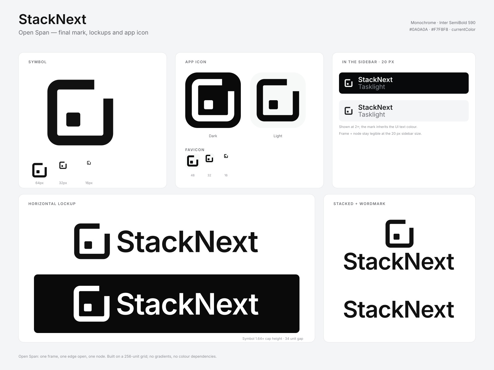

# StackNext brand

**Open Span** — one frame, one edge open, one node. The mark reads as a trace
that starts at a single span and continues outward: a boundary with a deliberate
opening rather than a closed loop.

StackNext is monochrome, local-first and evidence-led. The identity stays just
as restrained: two shapes, no gradients, no colour dependency and no remote
assets.



## Files

| Path | Use |
| --- | --- |
| `svg/stacknext-symbol.svg` | Primary symbol, ink `#111111`, 256-unit grid. |
| `svg/stacknext-symbol-currentColor.svg` | Same geometry with `fill="currentColor"` for UI code. |
| `svg/stacknext-symbol-black.svg` | One-colour black symbol. |
| `svg/stacknext-symbol-white.svg` | Reversed symbol for dark backgrounds. |
| `svg/stacknext-lockup-horizontal-black.svg` | Horizontal lockup, black. |
| `svg/stacknext-lockup-horizontal-white.svg` | Horizontal lockup, reversed. |
| `svg/stacknext-lockup-stacked.svg` | Stacked lockup, black. |
| `svg/stacknext-lockup-stacked-white.svg` | Stacked lockup, reversed. |
| `svg/stacknext-wordmark-black.svg` | Outlined wordmark only, black. |
| `svg/stacknext-wordmark-white.svg` | Outlined wordmark only, reversed. |
| `svg/stacknext-app-icon-dark.svg` | Rounded dark tile, white glyph. |
| `svg/stacknext-app-icon-light.svg` | Rounded light tile, black glyph. |
| `svg/stacknext-app-icon-flat-*.svg` | Full-bleed square tiles for platform masks. |
| `svg/stacknext-app-icon-maskable-*.svg` | Full-bleed maskable icons with safe-zone padding. |
| `svg/stacknext-app-icon-small-*.svg` | Small-size cut on a rounded tile (favicon companion). |
| `svg/stacknext-favicon.svg` | 32-unit inverse favicon, small-size cut. |
| `png/` | Transparent raster exports at 192–1600 px. |
| `web/` | Favicon ICO/PNG/SVG, Apple touch icon, PWA icons and `site.webmanifest`. |

All SVG masters are filled outlines. There are no strokes, filters, embedded
rasters or external references in the masters, so they scale and print cleanly.

## Geometry

The symbol is drawn on a 256 × 256 grid.

| Part | Value |
| --- | --- |
| Frame outer bounds | `34 … 222` (188 units) |
| Frame stroke | 28 units |
| Outer corner radius | 34 units |
| Inner corner radius | 6 units |
| Opening | 40 units at the top-right corner |
| Node | 40 × 40 units, `rx=6`, at `x=88 y=128` |

The node sits on the diagonal of the opening, at the lower left. That offset is
intentional: a centred node reads as a record button. Keep the node where it is.

The small-size cut uses a 32..224 frame, 32-unit stroke, 36/4 unit radii, a
56-unit opening and a 48 × 48 node. Use it for the favicon and dedicated small
raster icons; at 20 px and above in product UI, the standard cut keeps its
proportions better.

## Clear space and minimum sizes

- Keep clear space of at least **25% of the symbol height** on every side.
- Standard symbol: minimum **20 px** on screen, **6 mm** in print.
- Favicon / small cut: minimum **16 px**.
- Horizontal lockup: minimum **120 px** wide.
- Stacked lockup: minimum **96 px** wide.

## Colour

| Token | Value | Use |
| --- | --- | --- |
| Ink | `#111111` | Masters and wordmark. |
| Near-black | `#0A0A0A` | App tile and favicon glyph. |
| Paper | `#F7F8F8` | Light tile and favicon background. |
| White | `#FFFFFF` | Reversed glyph and wordmark. |

Do not introduce gradients, tints, shadows or a brand accent. In product UI the
symbol inherits the surrounding text colour with `currentColor`, so it follows
the dark and light themes automatically.

## Typography

The wordmark is **Inter SemiBold 590**, outlined at 132 px on the 256-unit
canvas, with tracking of `-0.02em`. The dashboard UI uses Inter Variable at
13 px for body text and 590 for headings, with 8 px radii and an 8 px spacing
grid. The wordmark is supplied as outlines; no font file is required to use it.

Inter is licensed under the SIL Open Font License 1.1. The wordmark outlines may
be used as part of the StackNext brand assets.

## Usage

Do:

- use the black symbol on light surfaces and the white symbol on dark surfaces;
- keep the horizontal lockup as the default when there is room;
- use the symbol alone for compact UI, app icons and favicons;
- preserve the opening and the off-centre node;
- keep the artwork proportional.

Do not:

- rotate, mirror or stretch the mark;
- close, move or enlarge the opening;
- centre the node or remove it;
- add colour, gradients, strokes, shadows or effects;
- place the mark on a busy photo without a solid container;
- set the wordmark in another typeface or re-type it.

## Web implementation

`packages/dashboard` uses the same geometry inline with `currentColor` at 20 px
in the sidebar, and ships the inverse small-cut favicon plus the ICO, Apple
touch and PWA icons from `web/`. The manifest lives at
`packages/dashboard/public/site.webmanifest`.

For another app, copy the contents of `web/` into its public directory and use:

```html
<link rel="icon" href="/favicon.ico" sizes="32x32" />
<link rel="icon" href="/favicon.svg" type="image/svg+xml" />
<link rel="apple-touch-icon" href="/apple-touch-icon.png" />
<link rel="manifest" href="/site.webmanifest" />
```

## Verification

The mark has been checked at 16, 20, 24, 32, 48, 64 and 1024 px, in one colour
on light and dark surfaces, and as a 20 px sidebar lockup in both dashboard
themes. The favicon uses a dedicated small-size cut because the master's
28-unit stroke and 40-unit node soften at 16 px; the cut keeps the opening and
node legible without changing the silhouette.

Trademark clearance and print colour proofing are still the responsibility of
the project before a public launch.
